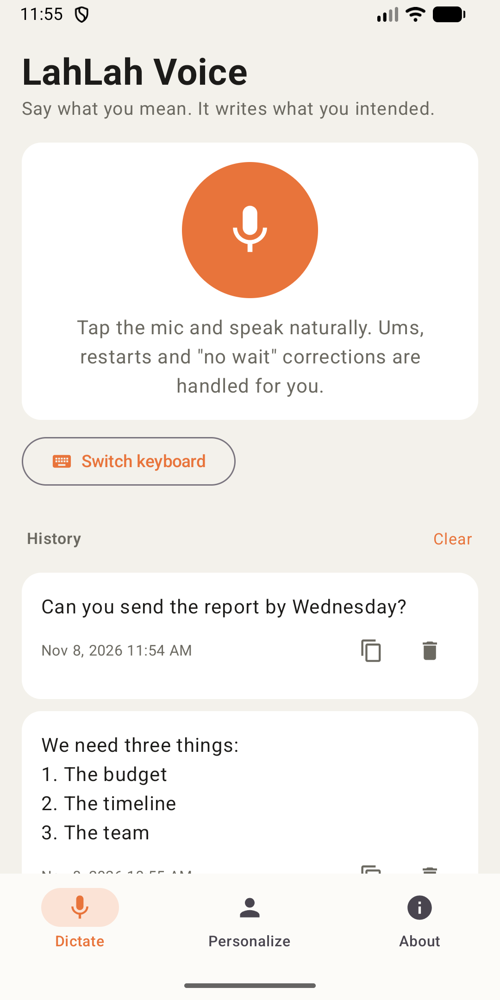
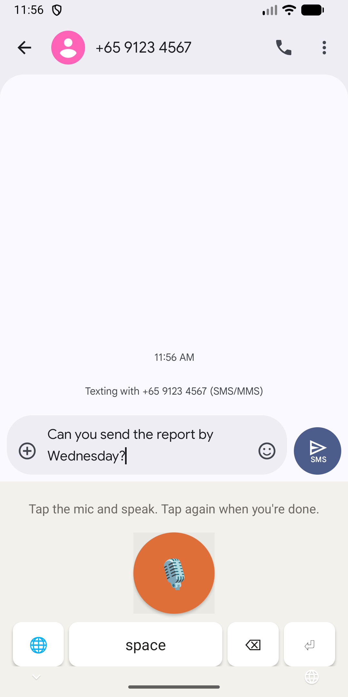
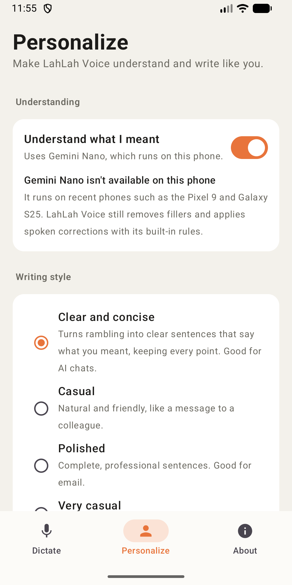
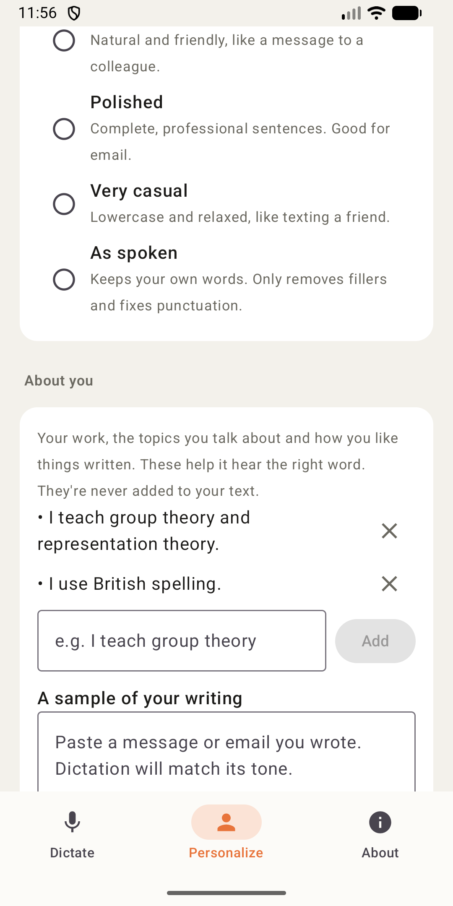

# LahLah Voice for Android

Say what you mean, in any app. LahLah Voice turns natural speech into finished text: it removes
pause fillers and false starts, follows spoken corrections ("Tuesday, no wait, Wednesday"), and
writes what you intended. Speech recognition and editing run on the phone.

This is the Android version of [LahLah Voice for Mac and iPhone](https://github.com/alfredang/lahlahvoiceapp).

| Dictate | Keyboard | Personalize | About you |
|---|---|---|---|
|  |  |  |  |

## Features

- **Dictate in the app:** tap the mic, speak, tap again. Copy or share the result.
- **Voice keyboard:** turn on the LahLah Voice keyboard and dictate into any app. Android, unlike
  iOS, lets a keyboard use the microphone once the app has permission.
- **Gemini Nano** (on supported phones such as the Pixel 9 and Galaxy S25) works out what you meant,
  fixes words the recogniser misheard and applies your writing style. Other phones use the
  built-in rules.
- **Writing styles:** Clear and concise, Casual, Polished, Very casual, As spoken.
- **About you:** notes ("I teach group theory") and a sample of your writing. They help the model hear
  the right word and match your tone, and are never added to your text.
- **Dictionary** for names and terms, and **history**, both kept on the phone.

## How it works

```
Microphone → Android SpeechRecognizer (on-device when available) → rules → Gemini Nano → dictionary → text
```

- **Rules** (`core/TranscriptCleaner.kt`) are a port of the Mac and iPhone rules: fillers,
  stutters, "scratch that", "no wait" corrections, spoken punctuation and numbered lists.
- **Gemini Nano** (`core/GeminiEditor.kt`) runs through Android AICore with ML Kit GenAI. Its output
  is rejected (`core/Faithfulness.kt`) if it answers a dictated question, invents a number or drops
  most of what was said. Any failure keeps the rule-based text.
- **Speech** (`speech/Dictation.kt`) prefers the on-device recogniser. If the phone lacks the offline
  pack for the language, it asks Android to download it and uses the standard recogniser meanwhile.
  Pauses don't end a dictation; tapping the mic again does.
- **Keyboard** (`ime/VoiceKeyboardService.kt`) is an input method with a mic, space, delete,
  enter and a key to switch back to your usual keyboard.

## Build

Requires JDK 17+ (Android Studio's bundled JBR) and the Android SDK (platform 36).

```bash
export JAVA_HOME="/Applications/Android Studio.app/Contents/jbr/Contents/Home"
./gradlew :app:testDebugUnitTest      # Rule, dictionary and faithfulness tests
./gradlew :app:assembleDebug          # Debug APK
./gradlew :app:bundleRelease          # Signed AAB for Google Play
```

Release signing reads `keystore.properties` and `upload-keystore.jks`, which are git-ignored.

| Path | Contents |
|---|---|
| `app/src/main/java/.../core` | Rules, Gemini Nano editor, faithfulness check, pipeline, storage |
| `app/src/main/java/.../speech` | Speech recogniser wrapper |
| `app/src/main/java/.../ime` | The LahLah Voice keyboard |
| `app/src/main/java/.../ui` | Dictate, Personalize and About screens (Jetpack Compose) |
| `screenshots`, `distribution` | Play Store screenshots, icon and feature graphic |

## Known limits

- Gemini Nano is only on recent flagship phones. Elsewhere the rules handle English fillers and
  corrections, but not tone or misheard words.
- AICore may decline Gemini Nano requests from the keyboard, since it isn't the app in front. The
  rules are used then.
- Spoken-correction rules are English. Other languages rely on Gemini Nano.

## Privacy and terms

No account, no server, no analytics. See the
[privacy policy](https://www.tertiaryinfotech.com/privacy) and
[terms of service](https://www.tertiaryinfotech.com/terms).

© 2026 Tertiary Infotech Academy Pte Ltd
